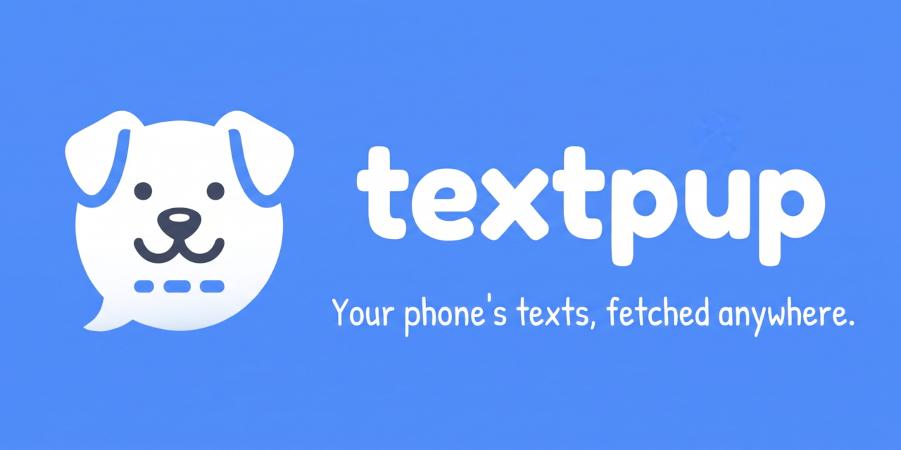

# TextPup Web & Backend Service

> Self-hosted, zero-knowledge encrypted messaging platform for Android cellular gateways.

**TextPup Service** pairs with the [TextPup Android Companion](https://github.com/your-org/textpup-app) to give you an end-to-end private desktop messaging platform. Send and receive cellular SMS and MMS across multiple SIM lines, backed by zero-knowledge encrypted storage, WebAuthn biometric passkeys, TOTP 2FA, and real-time SSE streaming.

---

## Key Features

- **Zero-Knowledge Architecture:** Message bodies, attachments, contact details, and recipient numbers are encrypted at rest with AES-256-GCM. Active keys are securely wiped from memory when the vault is locked.
- **Dual-SIM Routing & Multi-Device Hub:** Manage multiple cellular lines and companion devices. Choose line profiles per message or conversation.
- **Bi-Directional Real-Time Streaming:** Instant inbound/outbound messaging updates and live battery/radio telemetry via Server-Sent Events (SSE) and WebSockets.
- **MMS Media Engine:** Automatic high-resolution image compression, carrier-grade WebP thumbnail generation, and MP4 video poster transcoding using FFmpeg.
- **Hardware Passkeys & WebAuthn:** Unlock your vault with Touch ID, Windows Hello, Face ID, or hardware security keys (YubiKey), with mandatory TOTP 2FA and emergency recovery keys.
- **One-Click QR Code Pairing:** Generate cryptographically signed pairing payloads to onboard new companion phones in seconds.

---

## Tech Stack

- **Backend:** Node.js (v22+), Hono framework, WebSockets (`ws`), Drizzle ORM, `better-sqlite3`
- **Frontend PWA:** React 19, TypeScript, Vite, Tailwind CSS, Lucide Icons
- **Cryptography:** Argon2id key derivation, AES-256-GCM field and media encryption, HMAC-SHA256 blind indexing
- **Transcoding:** Sharp (WebP / image optimization), FFmpeg (video transcoding)

---

## Getting Started

### Option A: Docker Compose (Recommended)

```bash
# Clone the repository
git clone https://github.com/your-org/textpup-service.git
cd textpup-service

# Copy environment variables
cp .env.example .env

# Start containerized service
docker compose up -d
```

Visit **http://localhost:8080** to start the one-time interactive Setup Wizard.

### Option B: Local Node.js Development

```bash
# Clone and enter service directory
cd textpup-service

# Install dependencies (workspaces: server, web)
npm install

# Build web frontend and server
npm run build

# Run automated end-to-end verification tests
npm test

# Start the service
npm start
```

---

## Workspace Structure

```
service/
├── server/               # Hono backend, crypto enclave, database & routes
│   ├── src/auth/         # Passkeys (WebAuthn), sessions, rate limiting
│   ├── src/crypto/       # Zero-knowledge vault, AES-256-GCM, Argon2id
│   ├── src/db/           # Drizzle schema, migrations & SQLite client
│   ├── src/gateway/      # HostManager, WebSocket server, event bus
│   ├── src/media/        # Sharp & FFmpeg carrier transcoders
│   └── src/routes/       # REST API endpoints (threads, contacts, events)
├── web/                  # React + Vite frontend PWA
│   ├── src/components/   # AppShell, PillComposer, modals, UI kit
│   ├── src/hooks/        # useEvents (SSE listener), useTheme
│   └── src/pages/        # Dashboard, Messenger, Contacts, Settings
├── assets/               # Brand logos and graphics
├── Dockerfile            # Multi-stage production container build
├── docker-compose.yml    # Standard deployment orchestration
└── package.json          # Root npm workspace configuration
```

---

## License

MIT License. See `LICENSE` for details.
